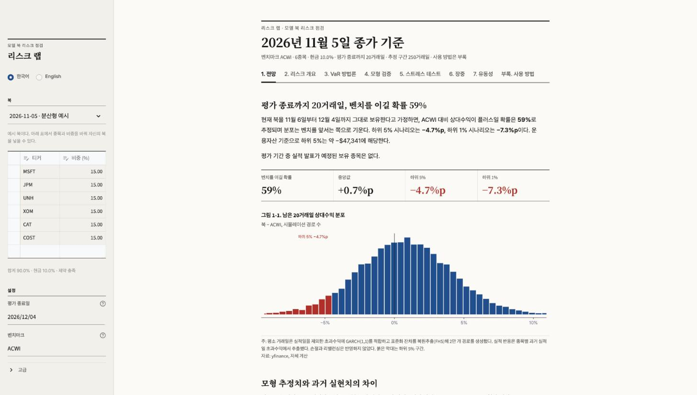
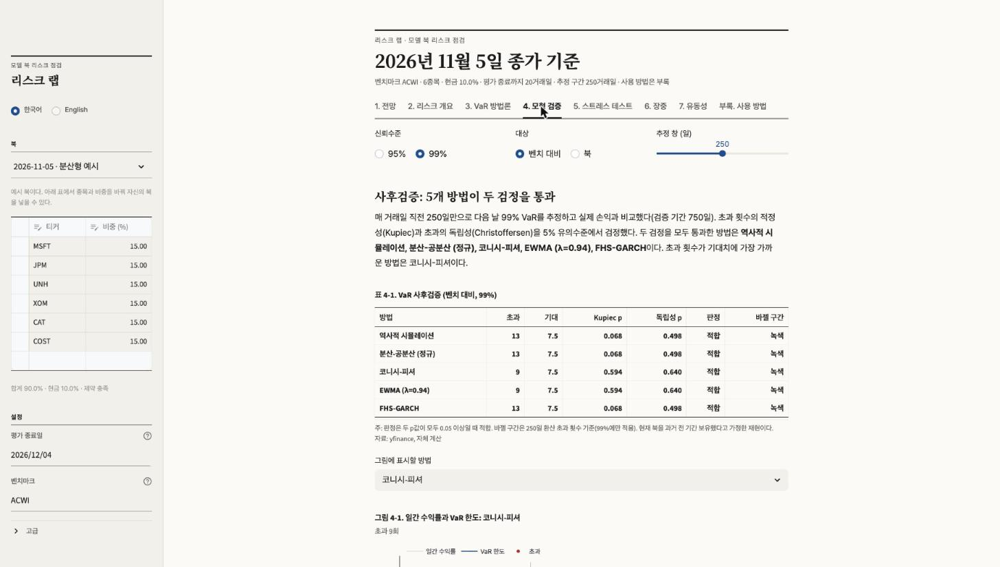
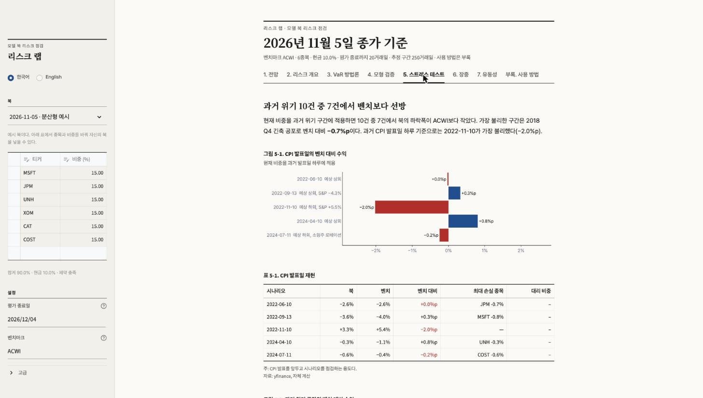

# 리스크 랩

[English](README.md) · **한국어**

주식 롱온리 북 하나를 실무 리스크 지표로 점검하는 Streamlit 앱이다.
Bloomberg Global Trading Challenge에 참가하는 동안 팀의 모델 북을 매일 점검하려고 만들었다.
대회는 벤치마크 대비 상대수익으로 순위를 매기므로, 모든 지표를 **절대**와 **벤치 대비** 두 가지로 낸다.



## 무엇을 답하나

| 장 | 질문 | 방법 |
|---|---|---|
| 1. 전망 | 평가 종료일까지 벤치를 이길 확률과, 질 때의 폭 | 실적일을 뺀 초과수익에 GARCH(1,1) → 필터드 역사적 시뮬레이션(FHS) 2만 경로 + 종목별 과거 실적일 반응을 점프로 추가. 모형 없는 과거 실현 분포와 나란히 비교 |
| 2. 리스크 개요 | 하루 손실 규모, 위험을 많이 내는 종목 | 역사적 VaR/ES, 베타·추적오차·정보비율, 정규 VaR 오일러 분해(기여 VaR) |
| 3. VaR 방법론 | 계산 방법에 따라 VaR가 얼마나 달라지나 | 역사적 · 분산-공분산 · 코니시-피셔 · EWMA(RiskMetrics) · FHS-GARCH · 몬테카를로(정규/다변량 t) |
| 4. 모형 검증 | 어떤 방법이 과거에 실제로 맞았나 | 롤링 사후검증, Kupiec POF · Christoffersen 독립성 · 조건부 커버리지, 바젤 신호등 |
| 5. 스트레스 테스트 | CPI 발표일이나 과거 위기가 다시 오면 | CPI 발표일 5건·위기 구간 10건 재현(상장 전 종목은 베타 대리), 5요인 회귀 기반 가상 충격 |
| 6. 장중 | 지금 벤치 대비 어디쯤인가 | 5분봉 상대수익을 VaR 선과 비교, 60초 갱신 |
| 7. 유동성 | 한 번에 다 팔 수 있나 | 일평균 거래대금 × 참여율 기준 청산 소요일 |

<p float="left">
  
  
</p>

## 설계에서 신경 쓴 것

- **상대수익 기준.** 순위는 벤치 대비 수익으로 정해지므로 VaR·ES·스트레스 결과를 모두 `북 − 벤치`로도 낸다.
- **실적일 이중계산 방지.** 평소 분포를 추정할 때는 과거 실적 반응일을 `β × 벤치`로 바꿔 빼고, 평가 기간에 실적이 있는 종목만 그 종목의 과거 실적일 초과반응을 따로 더한다. 점프 표본은 평소 하루치 고유 변동만큼 분산을 줄여 같은 날의 잡음이 두 번 들어가지 않게 한다.
- **실적 반응일.** 발표 시각이 개장(09:30 ET) 전이면 당일, 이후면 다음 거래일. 시각이 00:00으로 기록된 경우 두 후보 중 초과반응이 큰 날을 택한다. NYSE 휴장 달력을 쓴다.
- **look-ahead 없음.** 사후검증의 매일 예측은 그 전날까지의 창만 쓰고, GARCH 모수는 20일마다 재추정한다.
- **모형을 그대로 믿지 않게.** 1장은 모형 분포 옆에 같은 북의 과거 실현 분포와 분산비(Lo–MacKinlay 보정)를 함께 보여 준다. 둘이 다르면 그 이유(현재 변동성 국면)를 문장으로 설명한다.
- **장중 미완성 봉 제거.** 장중에 yfinance가 끼워 주는 당일 일봉을 표본에서 뺀다.
- scipy 없이 numpy·pandas만 쓴다. GARCH는 분산 타기팅으로 모수를 둘로 줄이고 격자 MLE를 벡터로 푼다.

## 실행

```bash
pip install -r requirements.txt
streamlit run app.py          # http://localhost:8501
```

처음 열 때 2007년부터의 가격을 받느라 20초 안팎이 걸린다. 저장소 루트에서 실행해야 `.streamlit/config.toml`(지면 색·글꼴)이 적용된다.
화면 언어는 사이드바에서 바꾸거나 주소에 `?lang=en` / `?lang=ko`를 붙여 정한다.

### 내 북 넣기

사이드바 표에서 티커와 비중(%)을 직접 고치면 된다. 여러 날짜의 북을 쌓아 두고 고르려면 JSONL 파일을 만들고 `BOOK_LOG` 환경변수로 가리킨다.

```jsonl
{"date": "2026-11-05", "kind": "내 북", "book": {"MSFT": 0.15, "JPM": 0.15, "XOM": 0.10}}
```

`BOOK_LOG`가 없으면 저장소의 `sample_books.jsonl`(가상 예시 북 2개)을 쓴다.

### Streamlit Community Cloud

share.streamlit.io → Create app → 이 저장소, 브랜치 `main`, 메인 파일 `app.py`.

## 검증

```bash
python3 -m pytest test_risk.py     # 또는 pytest 없이:
python3 -c "import test_risk as t; [f() for n,f in vars(t).items() if n.startswith('test_')]"
```

답을 아는 합성 데이터로 20개를 확인한다. 정규분포에서 방법별 VaR·ES가 이론값과 맞는지, 기여 VaR의 합이 포트폴리오 VaR와 같은지, 카이제곱 꼬리확률, 군집을 넣은 위반열을 독립성 검정이 잡는지, 시뮬레이션한 GARCH에서 모수를 되찾는지, 실적 반응일 매핑(개장 전·마감 후·금요일 마감 후·00:00), 점프 분산 가산, 분산비 불편성, NYSE 휴장 등이다.

## 구성

| 파일 | 내용 |
|---|---|
| `risk.py` | 계산 전부 (VaR·ES·GARCH·FHS·백테스트·스트레스·유동성) |
| `data.py` | 북 기록·가격·실적 일정 수집, NYSE 휴장 달력 |
| `ui.py` | 리포트 양식 화면 부품 (괘선 표, 그림·표 번호, 주석), 한국어·영어 전환 |
| `app.py` | 화면 |
| `test_risk.py` | 계산 검증 |

## 한계

- 모든 수치는 과거 데이터로 만든 표본내 추정이다. 최근 성적으로 고른 북이면 같은 구간의 정보비율·평균수익은 좋게 나온다.
- 1장은 북을 평가 종료일까지 그대로 보유한다고 가정한다. 손절·리밸런싱은 반영하지 않는다.
- 사후검증은 현재 북을 과거 전 기간 보유했다고 가정한 재현이다.
- 종목 간 실적 반응의 상관은 무시한다. 5요인 가상 충격은 설명력(R²)이 낮은 종목에서 방향 참고용이다.
- 가격·실적 일정은 yfinance에서 받는다. 분봉은 지연될 수 있고, 클라우드에서는 요청이 제한될 때가 있다.

투자 조언이 아니다. 예시 북은 가상이며 실제 보유가 아니다.
