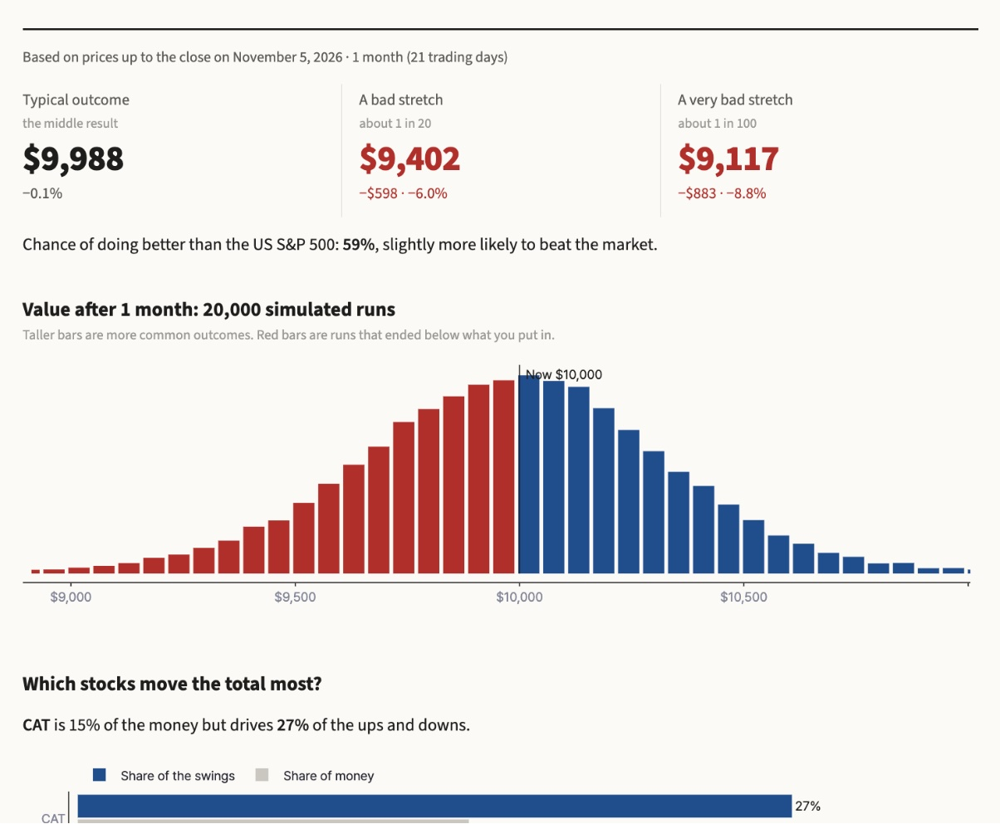
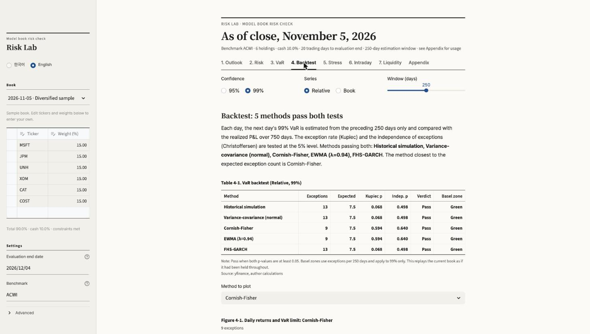
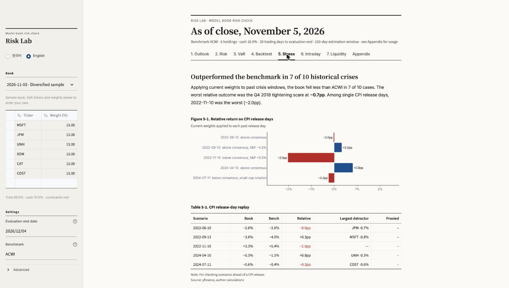

# Risk Lab

**English** · [한국어](README.ko.md)

**Live demo:** [giana-risk-lab.streamlit.app](https://giana-risk-lab.streamlit.app/?lang=en)

A Streamlit app that shows where a stock portfolio could be in a few weeks.

- **The front page is a calculator.** Enter stocks, an amount and a period, and it shows the value in a typical
  outcome, a 1-in-20 bad outcome and a 1-in-100 bad outcome, plus the chance of beating a market index. Below that:
  which stocks drive the swings, and what past crashes would have done to the same mix. Written for people with no
  finance background.
- **"Show the detailed analysis" opens the risk-desk view**: VaR and ES across methods, backtests, stress tests,
  performance attribution, intraday monitoring and liquidity. I first built it during the Bloomberg Global Trading Challenge to check our
  team's model book every day. The competition ranks teams on return relative to a benchmark, so this part reports
  every measure both in **absolute** terms and **relative to the benchmark**.



## Detailed analysis: what it answers

| Tab | Question | Method |
|---|---|---|
| Outlook | Probability of beating the benchmark over the chosen period, and how bad the downside is | GARCH(1,1) on excess returns with earnings days removed → filtered historical simulation (20,000 paths) + each holding's historical earnings-day reactions added as jumps. Compared side by side with the model-free realized distribution |
| Risk | Size of a one-day loss; which holdings drive risk | Historical VaR/ES, beta, tracking error, information ratio, Euler decomposition of normal VaR (component VaR) |
| VaR | How much VaR depends on the method | Historical · variance-covariance · Cornish-Fisher · EWMA (RiskMetrics) · FHS-GARCH · Monte Carlo (normal / multivariate t) |
| Backtest | Which method was actually right in the past | Rolling out-of-sample backtest; Kupiec POF, Christoffersen independence and conditional coverage; Basel traffic light |
| Stress | What if a CPI surprise or a past crisis repeats | Replay of 5 CPI release days and 10 crisis windows (holdings not yet listed are proxied by beta); five-factor regression shocks |
| Attribution | Why the mix beat or trailed the benchmark over the past 1–12 months | Buy-and-hold with drifting weights; per-holding contribution; Brinson-Fachler sector allocation vs selection (sector ETFs as benchmark sectors, benchmark weights rolled back from current fund data, reconstruction error shown); factor attribution with betas estimated before the period; Carino linking so every breakdown sums exactly to the active return |
| Intraday | Where the book stands versus the benchmark right now | 5-minute relative return against VaR lines, refreshed every 60 seconds |
| Liquidity | Can the book be exited quickly | Days to liquidate at a participation rate of average daily traded value |

<p float="left">
  
  
</p>

## Design decisions

- **Relative first.** Rankings depend on return versus the benchmark, so VaR, ES and stress results are all
  reported for `book − benchmark` as well as for the book.
- **No double counting of earnings.** When estimating the ordinary-day distribution, past earnings reaction
  days are replaced with `β × benchmark`. Only holdings that report within the evaluation window get a jump
  drawn from their own past earnings-day excess returns, and that jump sample is shrunk by one ordinary day of
  idiosyncratic variance so the same day's noise is not counted twice.
- **Earnings reaction day.** A report before the 09:30 ET open reacts the same day; anything later reacts the
  next trading day. When the time is recorded as 00:00, the candidate day with the larger excess reaction is
  used. Trading days follow the NYSE holiday calendar.
- **No look-ahead.** Each day's backtest forecast uses only data up to the previous close; GARCH parameters are
  re-estimated every 20 days.
- **Don't trust the model blindly.** The Outlook tab shows the model distribution next to the realized distribution of
  the same book and a variance ratio (Lo–MacKinlay corrected), and explains in words why they differ (usually
  the current volatility regime).
- **No partial bars.** When the app runs during the session, yfinance's unfinished daily bar for today is
  dropped from the sample.
- **numpy and pandas only.** No scipy: GARCH uses variance targeting to reduce the MLE to two parameters and
  evaluates a parameter grid in vectorized form.
- **Bilingual.** Every visible string is written in Korean and English; switch at the top right or with
  `?lang=en` / `?lang=ko`.

## Running locally

```bash
pip install -r requirements.txt
streamlit run app.py          # http://localhost:8501/?lang=en
```

The first load takes about 20 seconds to download prices back to 2007. Run from the repository root so the
page colours and fonts in `.streamlit/config.toml` apply.

### Using your own book

Edit tickers and weights (in percent) directly in the table on the front page. To keep a history of books and choose by
date, create a JSONL file and point the `BOOK_LOG` environment variable to it:

```jsonl
{"date": "2026-11-05", "kind": "My book", "kind_en": "My book", "book": {"MSFT": 0.15, "JPM": 0.15, "XOM": 0.10}}
```

Without `BOOK_LOG`, the app loads `sample_books.jsonl` (two hypothetical books).

### Streamlit Community Cloud

share.streamlit.io → Create app → this repository, branch `main`, main file `app.py`. Append `?lang=en` to the
app URL to open it in English.

## Tests

```bash
python3 -m pytest test_risk.py     # or, without pytest:
python3 -c "import test_risk as t; [f() for n,f in vars(t).items() if n.startswith('test_')]"
```

Twenty checks on synthetic data with known answers: each VaR/ES method against theoretical values under a
normal distribution, component VaR summing to portfolio VaR, chi-square tail probabilities, the independence
test catching clustered exceptions, recovery of GARCH parameters from a simulated series, earnings reaction-day
mapping (before open, after close, Friday after close, 00:00), variance addition from jumps, unbiasedness of the
variance ratio, and the NYSE holiday calendar.

## Structure

| File | Contents |
|---|---|
| `risk.py` | All calculations (VaR, ES, GARCH, FHS, backtests, stress, liquidity) |
| `data.py` | Book log, prices and earnings calendar; NYSE holiday calendar |
| `ui.py` | Page components (front-page figures, ruled tables, notes), money formatting (won or dollars), language switch |
| `app.py` | Page layout and text |
| `test_risk.py` | Calculation tests |

## Limitations

- All figures are in-sample estimates from historical data. If a book was selected on recent performance, its
  information ratio and mean return over the same window look better than they should.
- The outlook assumes the book is held unchanged until the evaluation date; stop-losses and rebalancing are not
  modelled.
- The backtest replays the current book over the full history; it is not the book's actual track record.
- Correlation between holdings' earnings reactions is ignored. Five-factor shocks are indicative only for
  holdings with low R².
- Prices and earnings dates come from yfinance. Intraday bars may be delayed, and requests from cloud hosts are
  occasionally rate-limited.

Not investment advice. The sample books are hypothetical and are not actual holdings.
